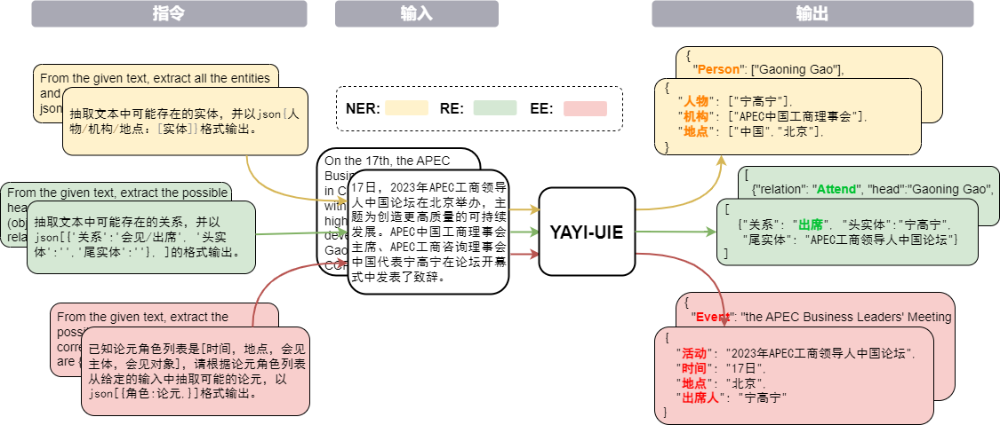
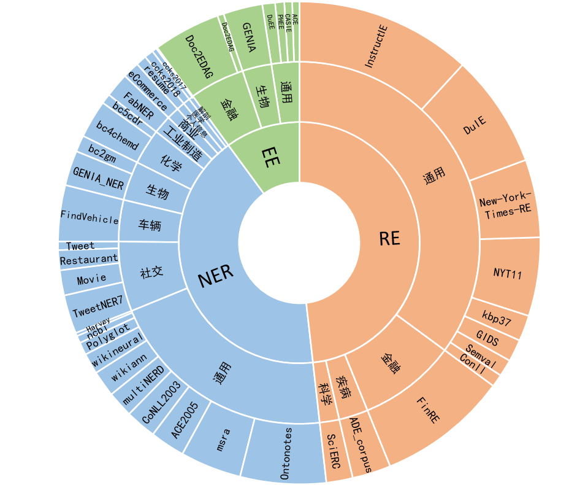
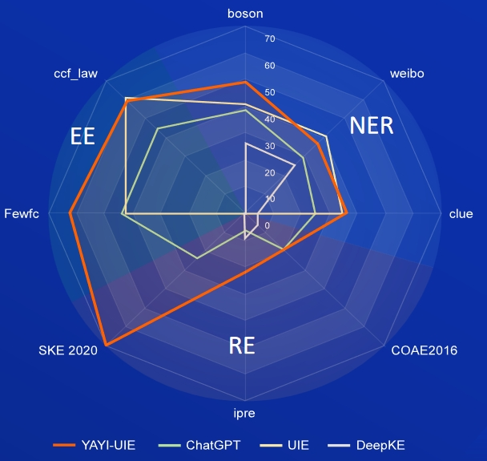

# YAYI UIE

<div align="center">

<br>

[](./LICENSE)
[](./LICENSE_DATA)
[](./LICENSE_MODEL)

[[📖README](./README_JP.md)] 
[[🤗HF Repo](https://huggingface.co/wenge-research)]
[[🔗URL](https://yayi.wenge.com)]

日本語 | [中文](./README.md) | [English](./README_EN.md)

</div>


## 紹介
YAYI Unified Information Extraction Large Language Model (YAYI-UIE)は、数百万の高品質データで微調整され、Named Entity Recognition (NER)、Relation Extraction (RE)、Event Extraction (EE)などのタスクを統合してトレーニングされています。このモデルは、一般、セキュリティ、金融、生物学、医学、ビジネス、個人、自動車、映画、産業、レストラン、科学などの多様な分野で構造化された出力を抽出することができます。

YAYI-UIEのオープンソース化は、中国のPLMオープンソースコミュニティの成長を促進することを目的としています。私たちは、パートナーと協力してYAYI Large Modelsエコシステムを開発することを楽しみにしています！



## ダウンロードリンク
| 名前 | 🤗 HF Model Name   |  ダウンロードリンク  |
| --------- | ---------    | --------- |
|  YAYI-UIE  | wenge-research/yayi-uie  | [モデルダウンロード](https://huggingface.co/wenge-research/yayi-uie)  |
| YAYI-UIE Data | wenge-research/yayi_uie_sft_data| [データダウンロード](https://huggingface.co/datasets/wenge-research/yayi_uie_sft_data)|


## トレーニングデータセット
100万件以上のコーパスのうち、54%が中国語、46%が英語です。データセットは、金融、社会、生物学、ビジネス、産業製造、化学、車両、科学、病気と医学、個人生活、セキュリティ、一般的なトピックを含む12の分野をカバーし、数百のシナリオを網羅しています：

- NER: 中国語では、個人、地政学、組織、身体部位、薬物など**28**種類のエンティティをカバーし、英語では、動物、武器、会議、本など**130**種類のエンティティをカバーしています。
- RE: 中国語では、買収、持株増加、再編、国籍、別名、親族、株式購入、譲渡、原因、発生場所、製造業者など**232**種類の関係を含み、英語では、創設者、州または本社の所在地、従業員、職業、創作者など**236**種類の関係を含みます。
- EE: 中国語では、入札、役員変更、製品行動 - 発売、会社上場など**84**種類のイベントをカバーし、**203**種類の引数を含みます。英語では、出生、デモ、会議、組織の終了、離婚など**45**種類のイベントをカバーし、**62**種類の引数を含みます。



## クイックスタート
#### conda環境のセットアップ
1. リポジトリをクローン

```bash
git clone https://github.com/wenge-research/yayi-uie.git
cd yayi-uie
```

2. conda環境を作成

```bash
conda create --name uie python=3.8
conda activate uie
```

3. 環境をセットアップ

```bash
pip install -r requirements.txt
```

#### 推論
私たちのモデルの重みはすでに[Huggingface](https://huggingface.co/wenge-research)でオープンソース化されています。
以下は、YAYI-UIEを使用して下流タスクの推論を行うためのコードスニペットです。これは単一のA100/A800 GPUで実行でき、bf16精度を使用して推論する場合、約33GBのGPUメモリを占有します。

```python
>>> import torch
>>> from transformers import AutoModelForCausalLM, AutoTokenizer
>>> from transformers.generation.utils import GenerationConfig
>>> tokenizer = AutoTokenizer.from_pretrained("wenge-research/yayi-uie", use_fast=False, trust_remote_code=True)
>>> model = AutoModelForCausalLM.from_pretrained("wenge-research/yayi-uie", device_map="auto", torch_dtype=torch.bfloat16, trust_remote_code=True)
>>> generation_config = GenerationConfig.from_pretrained("wenge-research/yayi-uie")
>>> prompt = "Text: Alberto Mancini won in the final 7–5 , 2–6 , 7–6 , 7–5 against Boris Becker . \nFrom the given text, extract all the entities and types. Please format the answer in json {location/person/organization：[entities]}."
>>> # "<reserved_13>" is a reserved token for human, "<reserved_14>" is a reserved token for assistant
>>> prompt = "<reserved_13>" + prompt + "<reserved_14>"
>>> inputs = tokenizer(prompt, return_tensors="pt").to(model.device)
>>> response = model.generate(**inputs, max_new_tokens=512, temperature=0)
>>> print(tokenizer.decode(response[0],skip_special_tokens=True))
```

初回のモデルのダウンロードと読み込みには時間がかかる場合があります。

#### サンプルプロンプト
注：
- 【】はモデルに実行させたいタスクを示すプロンプトで、オプションです。
- プロンプトに具体的なラベルを追加して、モデルがより包括的な情報を生成できるようにします。例えば、「会議場所」ではなく「場所」を使用します。
- テキストを最初に、指示を後に配置すると、より良い結果が得られます。
1. NER
```
Text:
From the given text, extract all the entities and types. Please format the answer in json {person/organization/location：[entities]}.
```
2. RE
```
Text:
From the given text, extract the possible head entities (subjects) and tail entities (objects) and give the corresponding relation triples.The relations are [country of administrative divisions,place of birth,location contains]. Output the result in json[{'relation':'', 'head':'', 'tail':''}, ].
```
3. EE
```
Text:
Given the text and the role list [seller, place, beneficiary, buyer], identify event arguments and roles, provide your answer in the format of json{role:name}.
```

## ゼロショット評価
1. NERタスク

AI，Literature,Music,Politics and Scienceは英語データセット; boson，clue and weiboは中国語データセット

| モデル | AI | Literature | Music | Politics | Science | EN Average | boson | clue | weibo | ZH Average |
| ------ | ------ | ------ | ------ | ------ | ------ | ------ | ------ | ------ | ------ | ------ |
| davinci | 2.97 | 9.87 | 13.83 | 18.42 | 10.04 | 11.03 | - | - | - | 31.09 |
| ChatGPT 3.5 | **54.4** | **54.07** | **61.24** | **59.12** | **63** | **58.37** | 38.53 | 25.44 | 29.3 |
| UIE | 31.14 | 38.97 | 33.91 | 46.28 | 41.56 | 38.37 | 40.64 | 34.91 | 40.79 | 38.78 |
| USM | 28.18 | 56 | 44.93| 36.1 | 44.09 | 41.86 | - | - | - | - |
| InstructUIE |	49 | 47.21 | 53.16 | 48.15 | 49.3 | 49.36 | - | - | - | - |
| DeepKE-LLM | 13.76 | 20.18 | 14.78 | 33.86 | 9.19 | 18.35 | 25.96 | 4.44 | 25.2 | 18.53 |
| YAYI-UIE | 52.4 | 45.99 | 51.2	| 51.82 | 50.53 | 50.39 | **49.25** | **36.46** | 36.78 | **40.83** |

2. REタスク

FewRe and Wiki-ZSLは英語データセット; SKE 2020, COAE2016 and IPREは中国語データセット

| モデル | FewRe | Wiki-ZSL | EN Average | SKE 2020 | COAE2016 | IPRE | ZH Average |
| ------ | ------ | ------ | ------ | ------ | ------ | ------ | ------ |
| ChatGPT 3.5 | 9.96 | 13.14 | 11.55  24.47 | 19.31 | 6.73 | 16.84 |
| ZETT(T5-small) | 30.53 | 31.74 | 31.14 | - | - | - | - |
| ZETT(T5-base) | 33.71 | 31.17 | 32.44 | - | - | - | - |
| InstructUIE |**39.55** | 35.2 | 37.38 | - | - | - | - |
| DeepKE-LLM | 17.46 | 15.33 | 16.40 | 0.4 | 6.56 | 9.75 |5.57|
| YAYI-UIE | 36.09 | **41.07** | **38.58** | **70.8** | **19.97** | **22.97**| **37.91**|

3. EEタスク

commodity newsは英語データセット, FewFC and ccf_lawは中国語データセット

EET（イベントタイプ抽出）

| モデル | commodity news | FewFC | ccf_law | ZH Average |
| ------ | ------ | ------ | ------ | ------ |
| ChatGPT 3.5 | 1.41 | 16.15 | 0 | 8.08 |
| UIE | - | 50.23 | 2.16 | 26.20 |
|InstructUIE| **23.26** | - | - | - |
| YAYI-UIE | 12.45 | **81.28** | **12.87** | **47.08**|

EEA（イベント引数抽出）

| モデル | commodity news | FewFC | ccf_law | ZH Average |
| ------ | ------ | ------ | ------ | ------ |
| ChatGPT 3.5 | 8.6 | 44.4 | 44.57 | 44.49 |
| UIE | - | 43.02 | **60.85** | 51.94 |
|InstructUIE| **21.78** | - | - | - |
| YAYI-UIE | 19.74 | **63.06** | 59.42 | **61.24** |




## 利用規約
#### 制限事項

データとベースモデルを使用してトレーニングされたSFTモデルには、以下の問題があります：

1. 抽出された情報が事実と異なる回答を引き起こす可能性があります。
2. 有害な指示を効果的に識別することができず、有害な発言を引き起こす可能性があります。
3. 段落レベルのテキストを含むシナリオでは、モデルの抽出能力が向上する必要があります。

#### 免責事項
上記のモデルの制限を考慮して、開発者はこのプロジェクトのコード、データ、モデル、および生成された派生物を研究目的のみに使用し、商業目的や社会に害を及ぼす可能性のある他のアプリケーションには使用しないことを要求します。ユーザーは、YAYI UIEによって生成されたコンテンツを識別して利用する際に注意を払い、有害なコンテンツをインターネット上に配布しないようにする必要があります。拡散者は、有害な結果に対して単独で責任を負います。

このプロジェクトは研究目的のみに使用されることを意図しています。このプロジェクトの使用によって生じるいかなる損害や損失についても、プロジェクト開発者は責任を負いません。詳細については、免責事項を参照してください。

#### オープンソースライセンス
このプロジェクトのコードとデータは[Apache-2.0](./LICENSE.txt)ライセンスの下でオープンソース化されています。YAYI-UIEモデルまたはその派生物の使用は、[Baichuan2](https://github.com/baichuan-inc/Baichuan2)のコミュニティおよび商業モデルライセンスに従う必要があります。

## 更新
- [2023/12/15] YAYI-UIEがリリースされ、オープンソース化されました。

## 参考文献 
- [YAYI](https://github.com/wenge-research/YAYI/blob/main/training/trainer.py)およびHuggingface [transformers](https://github.com/huggingface/transformers) ；
- オープンソースバージョンは[Baichuan2-13B](https://github.com/baichuan-inc/Baichuan2)に基づいて微調整されています；
- 分散トレーニングにはMicrosoft [DeepSpeed](https://github.com/microsoft/deepspeed)および[ZeRO stage 2](https://huggingface.co/docs/transformers/main_classes/deepspeed#zero2-config)の設定を使用しています；
- 以下のオープンソースプロジェクトのサポートに感謝します。[InstructUIE](https://github.com/BeyonderXX/InstructUIE/tree/master); [Baichuan2-Base](https://github.com/baichuan-inc/Baichuan2); [InstructIE](https://github.com/zjunlp/DeepKE/tree/main/example/llm/InstructKGC); [KnowLM](https://github.com/zjunlp/KnowLM/tree/main)

## 引用
このリソースを使用する場合は、以下の論文を引用してください：
```
@article{YAYI-UIE,
  author    = {Xinglin Xiao, Yijie Wang, Nan Xu, Yuqi Wang, Hanxuan Yang, Minzheng Wang, Yin Luo, Lei Wang, Wenji Mao, Dajun Zeng}},
  title     = {YAYI-UIE: A Chat-Enhanced Instruction Tuning Framework for Universal Information Extraction},
  journal   = {arXiv preprint arXiv},
  year      = {2023}
}
```

## Star History
[](https://star-history.com/#wenge-research/YAYI-UIE&Date)
